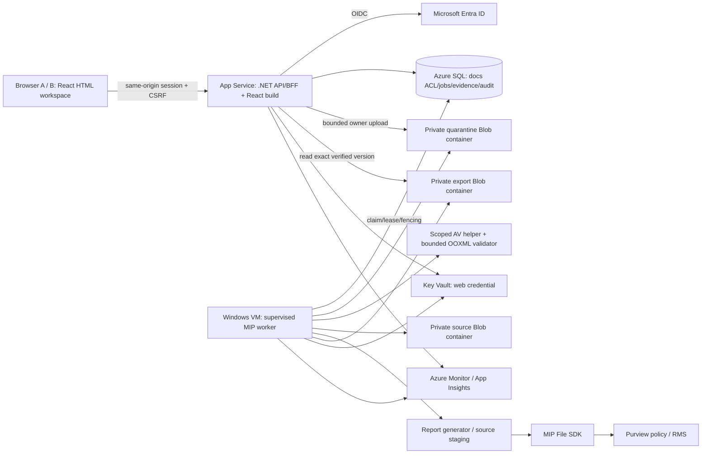
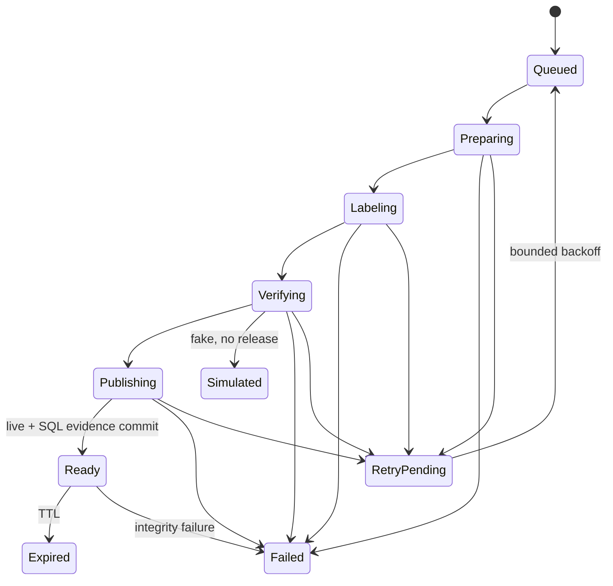

# 02 — Azure system architecture v4.2

> ADR-014 access update (20 October 2026): [Self-service Member workspaces](member-self-service-workspace.md) supersedes Publisher-only/pre-enrolled-owner empty-draft access below. Every verified internal tenant Member gets own private drafts; source RMS-owner mapping, reviewed recipients, scan/release and report/auditor controls remain. Approved tenant claim/enrollment rollout and live acceptance are tracked separately in ADR-014.

> ADR-013 update (19 October 2026): [Standalone owner-only MVP](standalone-owner-only-mvp.md) supersedes conflicting unprotected-library-source/service-owned-output assumptions below. External content connectors are deferred; Entra/MIP/Azure remain. Legacy library contracts below are implementation history until revised protected intake/owner mapping/G1/G2/G6 are proven. Report generation and all unaffected controls remain in scope.

> Current decision v4.2 (19 October 2026): ADR-012 removes the 3D renderer. Use the searchable HTML list/detail workspace with React/TypeScript and .NET BFF. Historical 3D evidence is not a current deliverable. All functional, security, native SDK and Azure controls remain required.

## Target topology



App Service ใช้ managed identity ของ web; VM ใช้ managed identity ของ worker SQL/Blob/Key Vault ใช้ private connectivity ตาม docs/11 Browser ไม่เข้าถึง source/export Blob โดยตรง Native MIP ไม่อยู่ใน web process

V4.2 frontend is React/TypeScript with searchable HTML list/detail controls. Compile static assets into the existing .NET web release. Server OIDC/cookie/CSRF and /api,/auth routes remain authoritative; SPA fallback cannot swallow API errors. See docs/15.

Web public HTTPS endpoint ยังมี Entra + application ACL และ demo network restrictions ตาม deployment target; VNet integration เป็น outbound connectivity ไม่ใช่การปิด public inbound โดยตัวมันเอง

## Components and identities

| Component | Responsibility |
|---|---|
| Web | OIDC, role/document ACL authorization, bounded request DTO, job/status/audit and authorized download |
| Domain/application | report rules, document versions, ownership metadata, recipient bindings, rights profile, state/release invariants |
| Azure SQL | durable queue + leases/fencing, source metadata/ACL, identity mapping, snapshots, artifacts/evidence/audit |
| Web intake | publisher+owner authorization, bounded upload stream to quarantine, metadata/ACL/version lifecycle; no original download |
| Worker on Windows VM | leased intake and export jobs, scanner-helper orchestration, bounded validator, source promotion, MIP apply/inspect and cleanup |
| Quarantine Blob container | immutable unique intake objects; never reader-visible or MIP-export input before evidence passes |
| Source Blob container | validated/published owner-uploaded synthetic XLSX; pinned hash/version; ingestion may promote new unique versions, export stage reads only |
| Export Blob container | unique candidate artifact objects; web read-only; worker write/delete; Ready controls publication logically |
| Key Vault | web and MIP processor certificate secrets separately scoped; managed identity retrieval |
| Monitoring | redacted metrics/traces/alerts; not native Purview audit |

Service principal remains candidate protection owner. Business owner derives from Entra session at create, has metadata/ACL/version/publish authority with DocumentPublisher role, not an implicit RMS grant. Requester becomes named recipient only for DocumentCopy. See docs/10–12.

## Intake before export

Owner create Draft → bounded upload to private quarantine → leased scanner/validator workflow → promote exact clean/valid bytes to new source version → persist Eligible evidence → explicit owner Publish. No direct web upload into published sources; input awaiting/error/unknown/fake scan cannot enter export pipeline. Full states, API and acceptance I01–I16 are in docs/12

Source promotion is a trusted write capability added in v3; enforce create-only keys and pinned versions/hash rather than claiming worker read-only as before. Source promotion/Blob and SQL are not transactional together: unbound objects stay private and not published. Web has no source/export-write rights; source bytes never returned via upload management APIs

Owner can upload a new version without disturbing current publication. Publish new version atomically switches current pointer/revision; Withdraw closes portal access. Copy processing/release/download rechecks current publication/version/ACL; already delivered protected copies are unaffected

## Unified pipeline for two sources

1. Web validates session tid/oid/roles; identifies ReportExport or DocumentCopy.
2. ReportExport: authorize report + parameters and snapshot report rule/dataset. DocumentCopy: require Published + CurrentPublishedVersionId + Eligible real scan/validation evidence, authorize current ACL, resolve immutable source/hash + validated RMS recipient mapping.
3. Transaction checks idempotency/admission; stores complete source/rule/rights/requester snapshot + Queued + audit.
4. Worker claims with lease/fencing. Recheck source/ACL/recipient mapping/config freshness and policy availability before processing; stale or changed input → fail, request a new job.
5. Generate report or fetch pinned Blob source version with conditional ETag; check hash. Source must be unprotected synthetic XLSX in MVP.
6. Use fresh attempt directory and handler. Report profile applies label according to rule. Document profile applies fresh custom protection for exactly the current recipient + approved rights and a UDP label per installed SDK's documented sequence.
7. Commit new output, dispose writer, open new handler and independently inspect label/protection; for DocumentCopy also inspect resulting users/rights and verify no unintended grants. If current API cannot provide sufficient readback, gate is unresolved; do not substitute intended input as observed evidence.
8. Hash verified local output; upload unique candidate Blob (no overwrite) and capture version ID/ETag. Verify uploaded bytes hash matches. Blob is private and has no route until a job is Ready.
9. Short SQL transaction, guarded by lease token/version: evidence + immutable artifact binding + Ready + audit. SQL failure leaves orphan private candidate for cleanup, never fallback release.
10. Clean plaintext staging. Download rechecks caller/source ACL/recipient binding/mode/TTL/evidence and retrieves exact blob version conditionally. Buffer ≤10 MB locally/in memory, verify SHA-256 before sending the first byte, then stream that same verified buffer. No re-fetch of latest Blob during stream.

Per-user artifact reuse across A/B is forbidden even if source bytes and label ID match. No mutable source replacement and no recipient list appended from previous jobs.

## Release invariant

```text
LiveMip AND Ready AND current requester/tenant/roles/ACL authorized
AND snapshot source/document version remains allowed
AND evidence refers to exact artifactId + blobVersionId + SHA256
AND independently observed label/protection matches expected profile
AND artifact not expired AND committed evidence/audit exists
AND for DocumentCopy: verified recipient mapping matches requester
    AND observed per-copy rights/recipients match approved profile
```

Server hash/evidence proves byte correspondence. Client allowed/denied tests independently prove the tested RMS behavior. Privileged protection owner/service recovery accounts are outside ordinary A/B denial tests and must be documented.

## State machine and durability



Worker lease/heartbeat persists in SQL for intake and exports. Stale workers cannot commit Eligible/Ready. Each retry uses new attempt directory/object ID; orphan cleanup checks active lease/DB binding before deleting. SQL transaction must not wrap scanner/SDK/network calls. One active task across intake/export baseline; bounded fair scheduler avoids starvation, restart/takeover tests still required.

Native hangs require supervised child process/helper coordination before retry. Cancelling managed Task is insufficient. Web recycle has no effect on durable jobs; VM worker downtime leaves pending intake/Queued exports visible, not falsely successful. Scanner elevation must stay in a narrow validated helper, not web/MIP worker privileges.

## Policy and data lifecycle

Separate cache per tenant+processor; custom protection descriptors created fresh per job. Do not put recipient rights into a shared mutable engine object. Native thread-safety assumptions must be proven.

Rules/rights profiles are versioned; service policy cannot be frozen by snapshot. Refresh strategy/freshness target 15 minutes is a gate, not an SDK guarantee. User-defined file rights also do not imply centrally editable grants after download; document limitations in docs/10.

SQL is authoritative TTL/release gate. Blob cleanup/lifecycle is secondary housekeeping and may run later. Azure retention/version/soft-delete settings affect retained billed bytes, not access through the application. Cloud artifacts are not authoritative on App Service local disk.

## Local development and evolution

Use SQL Server-compatible local DB and private filesystem adapters for no-cost offline development. These do not validate Azure networking/RBAC/Blob semantics. G5 runs the same contracts on Azure SQL/private Blob and cloud compute. Do not use SQLite migrations/tests as proof of SQL Server locking semantics.

No Service Bus, AKS, ACR or distributed worker fleet in baseline. Add them only after measured need and explicit architecture change.
