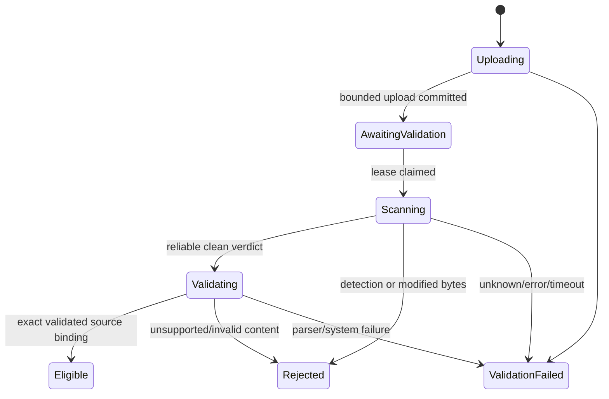

# 12 — Owner upload, document lifecycle and publishing v3

> ADR-014 access update (20 October 2026): [Self-service Member workspaces](member-self-service-workspace.md) supersedes Publisher-only/pre-enrolled-owner empty-draft access below. Every verified internal tenant Member gets own private drafts; source RMS-owner mapping, reviewed recipients, scan/release and report/auditor controls remain. Approved tenant claim/enrollment rollout and live acceptance are tracked separately in ADR-014.

> ADR-013 update (19 October 2026): [Standalone owner-only MVP](standalone-owner-only-mvp.md) supersedes conflicting unprotected-library-source/service-owned-output assumptions below. External content connectors are deferred; Entra/MIP/Azure remain. Legacy library contracts below are implementation history until revised protected intake/owner mapping/G1/G2/G6 are proven. Report generation and all unaffected controls remain in scope.

> Current decision v4.2 (19 October 2026): ADR-012 removes the 3D renderer. Use the searchable HTML list/detail workspace with React/TypeScript and .NET BFF. Historical 3D evidence is not a current deliverable. All functional, security, native SDK and Azure controls remain required.

User-approved scope: เพิ่มแหล่งนำเข้าผ่านเว็บโดย Document Publisher/Owner พร้อม metadata, ACL, version และ publish/withdraw เพื่อให้วงจร portal ครบ รายงานเดิมและ per-user protected download ยังคงอยู่ เอกสารนี้เป็น requirement/design ยังไม่มี application implementation หรือผลทดสอบ scanner

## Roles and ownership

- `DocumentPublisher` เป็น app role ที่ admin assign; มี role นี้จึงสร้างเอกสาร/อัปโหลดได้
- ตอน POST create document ระบบใส่ owner=(validated tid,oid) ของ caller ไม่รับ owner จาก body
- การอัปโหลด version, แก้ metadata/ACL, publish และ withdraw ต้องมี DocumentPublisher **และ** เป็น owner ของ document ใน tenant เดียวกัน
- Owner เดิมที่ถูกถอน publisher role อาจดู metadata ของตนได้ แต่ mutation ต้องถูกปฏิเสธตาม session/role freshness contract; ไม่มี owner transfer UI ใน MVP
- Owner กำหนด `CanRequestProtectedCopy` ให้ principal tid/oid ที่อยู่ใน server-managed same-tenant allowlist ได้ ไม่รับ arbitrary email/foreign principal/domain grant
- ผู้ขอสำเนายังต้องมี LibraryReader+ACL และ validated recipient mapping; owner ไม่ได้รับสิทธิ์ RMS/job download ของคนอื่นโดยอัตโนมัติ
- Owner ต้องการสำเนาของตนให้เพิ่มตนใน ACL และมี LibraryReader เช่นเดียวกับคนอื่น ไม่มี raw-original download endpoint แม้เป็น owner

## Screens and use cases

1. **เอกสารของฉัน:** owner เห็น Draft/Published/Withdrawn และประวัติ versions/validation โดยไม่เห็น job/artifact ของผู้อื่น
2. **สร้างเอกสาร:** title, purpose และ requester allowlist; owner derive จาก session, protection profile server-fixed ไม่เลือก unrestricted recipients หรือ label เอง
3. **อัปโหลด:** หนึ่ง `.xlsx` ต่อ version; แสดง progress ระดับ HTTP upload แยกจาก scan/validation progress
4. **ตรวจสอบ:** AwaitingValidation/Scanning/Validating/Eligible หรือ Rejected/ValidationFailed; ไม่มีปุ่ม publish จน Eligible และ server ยังตรวจซ้ำเสมอ
5. **เผยแพร่:** owner เลือก eligible version แล้ว publish ด้วย optimistic concurrency
6. **เปลี่ยน version:** upload ใหม่โดยไม่ overwrite bytes/source references เดิม; published version เก่ายังมีผลจน publish ใหม่สำเร็จ
7. **ถอนเผยแพร่:** หยุดการเห็นใน reader catalog/ขอ copy ใหม่และ download job เดิมผ่าน portal ของ document นั้น; สำเนาที่ออกไปแล้วไม่ถูก revoke โดย portal action

Demo ใช้ XLSX สังเคราะห์ของ owner O1/O2 ที่อัปโหลดผ่านหน้าจอจริง Seed tool ยังมีประโยชน์สำหรับ fixtures/tests แต่ต้องผ่าน validation contract เดียวกัน ไม่ใช้ seed bypass เป็น main showcase path

## Supported upload contract

- File bytes ≤10 MiB; HTTP request limit 12 MiB including multipart overhead. Enforce at hosting/proxy/app/stream layers; stop reading at bound, not after storing unlimited bytes
- Extension `.xlsx`, expected media type และ OOXML package structure ต้องสอดคล้อง; MIME/header/ชื่อไฟล์ไม่ใช่หลักฐานชนิดไฟล์ลำพัง
- Server generates IDs/blob keys; client filename เป็น display metadata ที่ sanitize/HTML encode ไม่ใช้เป็น path/command/SQL
- Unprotected XLSX เท่านั้น; reject password-encrypted/MIP-protected/signed files ใน MVP; no decryption fallback
- Reject macros, embedded/OLE objects, external workbook links/connections, unsafe package relationships, path traversal/duplicate ZIP entry ambiguity และ malformed packages
- Parse archive/XML ใน isolated validation process หลัง AV gate, disable DTD/external entity resolution และไม่ execute/calculate formulas เปิด workbook ด้วย Office/COM ไม่ได้
- Demo parser limits: ≤1,000 archive entries, ≤100 MiB total uncompressed content, ≤100 compression ratio per entry, ≤50 sheets, ≤100,000 populated cells, 60-second structural validation timeout. Treat these as application design limits to test/tune, not SDK limits
- Internal workbook formulas may be retained as data but not evaluated by server; reject externally referring/DDE relationships and unsupported active-content structures. Parser must fail closed on unsupported feature; no claim to safely parse every XLSX
- Keep synthetic demonstration data; upload capability does not authorize using real employee/customer files in this demo environment

## Intake pipeline and source integrity

1. Authorize publisher+owner+tenant; create version and intake operation with idempotency/admission controls in SQL. Existing published pointer unchanged
2. Stream incoming bytes to private `quarantine` blob with server-generated unique name/create-only condition; compute SHA256/count while streaming, record exact blob version/ETag
3. Mark intake AwaitingValidation transactionally only after upload completes and blob binding exists. Partial/missing uploads cannot publish; failed SQL upload binding leaves private orphan for cleanup
4. Ingestion worker claims durable intake lease/fencing; revalidate owner/document status and exact quarantine bytes. Malware scan must complete before opening ZIP/OOXML in application parser
5. Run trusted scanner against private local staging; scanner result must bind exact input hash, scanner platform/engine/security-intelligence version, scan run/time and unambiguous verdict
6. Only Clean proceeds to bounded package validation and unprotected-XLSX check. Infected/Remediated/Unknown/Error/Timeout/NotScanned/Disabled must not become Eligible
7. Validate SHA256 after scan and parse: modified or remediated bytes are not silently accepted as original upload. If AV removed/quarantined the file, reject it
8. Promote same verified bytes to new create-only source blob; capture source version/ETag/hash. Source reads for exporting use this binding only, never quarantine or latest mutable key
9. Fenced SQL transaction stores ScanEvidence+ValidationEvidence+DocumentVersion Eligible+Source binding+audit. Source orphan from SQL failure is inaccessible; cleanup separately
10. Owner can publish only that eligible immutable version through a separate explicit action; upload/scan success does not auto-publish

Malware scan result says no threat detected by that engine/run, not a guarantee of malware absence. MIP SDK is not antivirus. User checkbox, filename/MIME validation or fake scanner cannot substitute a real clean verdict

## Scanner baseline and feasibility G6

Candidate for the first Azure VM deployment: Microsoft Defender Antivirus on supported Windows Server, invoked through a fixed trusted scanner adapter/supervised helper. Confirm actual availability/mode/signature updates/licensing with environment owner; application intelligence freshness target ≤24h must be evidenced, not assumed. Do not assume MDE onboarding/license automatically exists

MpCmdRun is documented for scanning but its general exit code 0 can mean either no malware or malware successfully remediated [S28]. Therefore **exit code 0 alone is not Clean**. Validate exact command mode/platform output/detection signals, elevated execution requirements and unchanged input hash before implementing the adapter. Never disable host protection or exclusions to force PASS

Run web and application worker without administrator rights. If scanner invocation requires elevation, use a narrowly scoped helper/service with authenticated local IPC, fixed scan command, server-generated file token and path containment checks; no caller-provided executable/arguments. Do not elevate the whole web/MIP worker. Prove helper isolation, cancellation and result semantics in G6 before live uploads

If Defender Antivirus cannot give reliable non-remediation/clean evidence in the target environment, live publishing stays blocked until scanner integration is resolved. Changing scanner implementation requires ADR and tests, not bypassing scan

Optional cloud alternative: Defender for Storage on-upload malware scanning, priced/enabled separately only after target decision. If selected, authoritative result must correlate exact blob/hash/version via trusted delivery/query. Blob index tags alone are tamperable and not sole publish authority [S30]. Encrypted outputs cannot be assumed scannable; scan uploaded plaintext before protection. Do not deploy this alternative by default or add Event Grid merely as unused infrastructure

## States and version behavior

Document publication status = Draft / Published / Withdrawn. DocumentVersion intake state = Uploading / AwaitingValidation / Scanning / Validating / Eligible / Rejected / ValidationFailed. Versions published previously remain recorded as Superseded through publication history, not overwritten

Publish operation atomically validates document rowversion+Eligible evidence+source binding+owner/role+ACL configuration, switches CurrentPublishedVersionId and stores publication audit. No DB transaction around Blob/network operations. Use prevalidated immutable source plus conditional checks and fail if integrity/freshness no longer valid

New version upload does not hide working previous version. Publish new version supersedes old: no new copy requests or portal downloads from old version afterward; queued/in-progress jobs and old Ready jobs fail current-published-version checks before release. Already downloaded copies remain governed by their embedded MIP rights

Withdraw sets status Withdrawn and increments publication/ACL revision in one SQL transaction+audit. Reader requests/status/download recheck publication/ACL; failure to audit means withdrawal transaction not committed. Source cleanup is not required to enforce withdrawal. Pending requests/downloads started after commit are denied; bytes already sent or in-flight response begun before commit cannot be recalled

## Metadata/ACL policy

Owner may change title/purpose/requester allowlist; no owner/protection owner/label/rights/client path fields accepted. Use If-Match revision/rowversion for all mutations. ACL edits are atomic with audit and revision; effect applies to subsequent authorization checks subject to documented identity session freshness

Copy request stores requester authorization and document revision snapshot but not blanket irrevocable approval; it rechecks current publication/ACL at processing/release/download. Job evidence preserves historical owner/title/version but cannot grant access based solely on historical ACL

## APIs added

| Method/path | Contract |
|---|---|
| POST `/api/documents` | publisher; title,purpose,allowedRequesterIds from server allowlist; owner derived; 201 Draft |
| GET `/api/my/documents` | owner-scoped drafts/versions/status; excludes other owner private entries |
| PATCH `/api/documents/{id}` | publisher+owner, If-Match; title/purpose/ACL only; 200 updated revision |
| POST `/api/documents/{id}/versions` | publisher+owner, If-Match; bounded multipart XLSX + Idempotency-Key/CSRF; 202 intake version |
| GET `/api/documents/{id}/versions/{versionId}` | publisher-owner metadata, validation result/correlation ID; no raw file |
| POST `/api/documents/{id}/publish` | publisher+owner, If-Match; body versionId; 200 or 409 not eligible |
| POST `/api/documents/{id}/withdraw` | publisher+owner, If-Match; 200/idempotent current state |
| GET `/api/document-requester-options` | publisher only; bounded same-tenant demo principal IDs/aliases, no directory-wide dump |

Upload idempotency `(tid,oid,documentId,key)` persists intake+digest; compare actual uploaded bytes hash + canonical metadata. Same key/same content returns same version, different content →409; parallel retries create at most one bound intake. Request interruption/status can be retried by same key; abandoned incomplete objects cleaned. Do not treat supplied checksum as measured hash

Return 413 too large, 415 unsupported type, 409 invalid transition/version conflict, 412 stale If-Match, 403 missing role; foreign tenant/owner resources 404. Async rejection returns metadata state+safe error, not raw scanner logs. No HTML rendering or workbook preview of unvalidated bytes

## Data additions

- Document: ownerTid/Oid, publicationStatus, currentPublishedVersionId, revision, aclRevision, title/purpose, createdAt/updatedAt
- DocumentVersion: uploadedByTid/Oid, intakeId, originalDisplayName, intakeState, quarantineBinding, measured hash/size, sourceBinding, createdAt/validatedAt, safe rejection reason
- IntakeJob: durable lease/fencing/attempts/timeout, mode, idempotency/digest, stage, eligible source binding
- ScanEvidence: input hash, actual engine/provider/signatures/platform, clean/detection/unknown verdict, timestamps, run ID, mode, controlled diagnostic reference
- ValidationEvidence: same hash, parser/build/profile version, OOXML/unprotected-content checks and structural limits/results
- PublicationEvent: document revision, versionId, actor, publish/withdraw/ACL-change event, timestamp and audit correlation

Scan/validation evidence is append-only by app semantics and ties to exact source bytes; not native Purview alert, not immutable ledger. SimulatedScan verdict cannot make live-eligible/published source or live copy. Fake workflow may show `Simulated` status to owner but never enter reader catalog/live release

## Storage/RBAC change

Add private quarantine container. Web MI gains upload rights only at quarantine scope, still no source read/write or export write. Client receives no SAS/blob path. Worker gains quarantine read/cleanup and source promotion permission via reviewed custom read/write-no-delete source role or equivalent isolated ingestion identity; fixed promotion logic uses unique create-only blob keys. Ordinary export processing remains read-only on sources

Azure RBAC write permission is not a cryptographic write-once guarantee. Existing source version/hash references must be pinned and audited; granting source promotion capability is a change from the v2 read-only worker baseline. Container role scope/custom actions and privileged VM/helper trust boundary must be proven in G5/G6; do not claim separate same-VM processes withstand host compromise

## Limits, cleanup and acceptance

Intake queue cap 20, one active ingestion attempt initially; share a bounded worker scheduler with exports and prevent starvation. Scan timeout 120 seconds, structural validation timeout 60 seconds as application targets; maximum 3 attempts for transient system failure only. Owner re-upload/new version for content rejection. Native AV timeout may need helper/process coordination; prove cleanup/no orphan scan before retry

Quarantine objects target deletion within 24 hours after terminal intake/abandoned upload; successful promotion can delete sooner. Keep only redacted evidence for rejected files. Source retention independent from export 60-minute TTL; keep published/historical eligible source versions for demo lifecycle unless explicitly removed by operator after review. Withdraw is logical access control, not physical deletion/revocation. Soft-delete/backups affect residual retention/cost

### I01–I16 acceptance cases

| ID | Case | Expected |
|---|---|---|
| I01 | no publisher role/foreign owner mutates | denied server-side |
| I02 | owner injected in create/upload | strict DTO rejects forbidden owner field; actual owner always session identity |
| I03 | valid O1/O2 upload | own Draft, private quarantine, measured bytes/hash/version |
| I04 | spoof extension/MIME, encrypted/protected/active-content/zip-bomb | rejected without publish or MIP export |
| I05 | scan infected/remediated/unknown/disabled/stale definitions/timeout | no Eligible/Published; fake no live publish |
| I06 | exit0 with remediated signal or changed bytes | not Clean; cannot publish |
| I07 | clean scan+bounded structural validation | exact hash source promoted; eligible evidence bound |
| I08 | publish while pending/rejected/tampered evidence | 409/blocked, no reader visibility |
| I09 | eligible owner publish | atomic current version+audit; ACL readers see it |
| I10 | failed new upload while older published | old version remains available; no overwrite |
| I11 | publish version2 / withdraw races with queued and Ready copies | current version/publication/ACL rechecks deny old/withdrawn access |
| I12 | stale If-Match, repeated upload key, concurrent mutations | 412/409 or single idempotent intake; no lost update |
| I13 | source promotion/SQL partial failure or interrupted upload | no published orphan, cleanup bounded |
| I14 | raw quarantine/source URLs and other-owner draft status | inaccessible to readers/other owner |
| I15 | upload→scan→publish→A/B own copies→cross-open | full live path succeeds; crossed files denied |
| I16 | withdraw after copies downloaded | portal stops future downloads; reports explicit non-revocation of existing copies |

G6 = live intake/scanner/helper evidence plus all applicable I-cases; local fake only proves application control flow. G5 additionally tests actual Azure intake/quarantine/promotion/credentials. Both needed for complete v3 showcase
