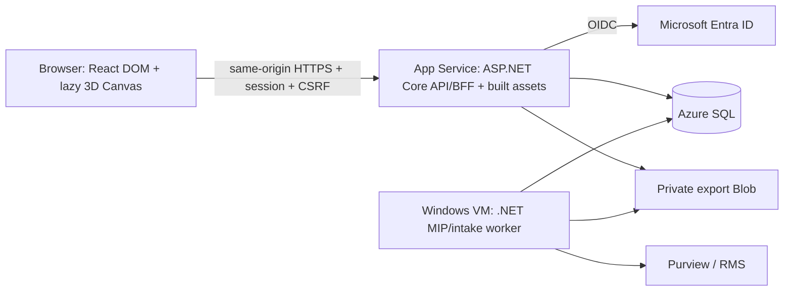

> Historical v4.1 assessment, superseded by ADR-012. The renderer is removed from current scope. Read ../15-long-term-stack-assessment.md for the current decision.

# 15 — Long-term stack assessment and adopted decision v4.1

Reviewed 16 October 2026. User clarified that references mean actual interactive 3D/game-like website, not a static isometric illustration, and authorized a stack change if supported by assessment. This document adopts React frontend + ASP.NET Core backend + existing .NET MIP worker. No React application/3D scene has been implemented or benchmarked in this revision.

## Executive decision

**Change the frontend to React/TypeScript. Keep the .NET API, MIP/native worker, security rules and Azure data architecture.** Make 3D a real interactive product module, with a complete accessible list mode that uses the same authorized application state.

Razor Pages was chosen to minimize initial implementation/tooling complexity, not because MIP SDK requires it. Razor could host client-side 3D scripts, but assembling React components/scene state as islands while keeping a separate Razor UI would add two UI systems to maintain. For this product's clarified interaction direction, one React UI is the more coherent engineering choice.

This is a design judgment for this application, not a claim that React is inherently more secure/faster/more scalable than Razor. MIP backend compatibility is a separate gate that neither frontend solves.

## Alternatives and tradeoffs

| Option | Strength | Long-term burden | Judgment for this project |
|---|---|---|---|
| Razor Pages + vanilla Three.js | simpler server-rendered forms, one web runtime | native React catalog components need porting; custom scene/UI synchronization, mixed imperative state | good for primarily forms plus a small scene; less aligned with requested 3D-rich workspace |
| Razor + multiple React islands | incremental adoption | dual rendering/state/focus/build models, unclear boundaries as interactions grow | avoid as default because no existing production UI must be preserved |
| React + Vite + ASP.NET Core same-origin API/BFF | one interactive UI model, direct React component ecosystem, dedicated .NET business layer | TypeScript + C# toolchains, routing/cache/form/error conventions must be selected and maintained | **selected** |
| Next.js + ASP.NET Core | useful if public SEO/SSR/RSC becomes important | potential extra server/runtime/routing/cache/auth responsibility overlapping .NET | not selected for authenticated document portal; revisit when an actual requirement justifies it |
| React + Node backend replacing .NET | JS throughout web tier | would still need separate native MIP integration/service; unnecessary rewrite of security/jobs/intake | not selected |

React recommends starting with a framework for many apps and documents that build-tool-only setup requires choices for routing/data access [S33]. Our explicit constraint is an existing dedicated .NET backend; the SPA baseline therefore pins router/query/forms conventions instead of assembling new patterns per screen. This is not an assertion that Vite supplies those capabilities itself.

## Selected stack

| Concern | Selection and boundary |
|---|---|
| UI | React + TypeScript, Vite build; current supported exact versions pinned after compatibility spike |
| Routing | React Router in client/data-router mode; do not silently enable a second server/SSR framework |
| Styling/components | Tailwind + reviewed shadcn-style primitives; selective 21st.dev source with original-license/dependency register |
| Server state | TanStack Query for authorized API state, job polling/invalidation; no second independent source of truth for 3D |
| Forms | React Hook Form + Zod for client validation; C# validation remains authoritative; exact packages reviewed/pinned |
| 3D | Three.js + React Three Fiber + selective Drei helpers; dynamic import/Suspense/error boundary, same app domain adapter |
| 2D motion | CSS first; optional Motion library only for demonstrated interaction needs, not initial dependency by habit |
| API/session/BFF | ASP.NET Core .NET 10; OIDC/Microsoft.Identity.Web as validated, Secure HttpOnly cookie and explicit CSRF contract |
| MIP/intake | existing .NET Windows worker + File SDK + scoped scanner/validator, unchanged release/recipient invariants |
| Hosting | same App Service serves compiled React assets + API/session; Windows VM worker + Azure SQL/Blob/Key Vault/Monitor |
| Tooling | supported Node LTS in build/CI + .NET SDK; Node is not required as a production web server by this design |
| Contract/testing | OpenAPI-generated TypeScript DTOs, compatible schema changes, backend tests + frontend/component and browser/3D fallback tests |

These library choices must be checked as a compatible version set and licensed dependencies at implementation, not installed using unreviewed `latest` commands. React/R3F peer compatibility is specifically a G7 gate [S34].

## Deployment and authentication: separated source, one web deployment



- Build frontend and backend as separate projects in one repo; release one versioned web artifact containing static frontend assets and .NET server. Worker is a separate versioned deployment as before.
- Frontend build output only in `wwwroot/app` or equivalent static assets; private reports/quarantine/certificates/cache never under wwwroot. Generic 3D assets are public client resources; never embed confidential source contents or unauthorized metadata into models/textures/bundles.
- `/api/*` and `/auth/*` are server-owned routes and must never fall back to SPA index. SPA navigation fallback only for intended UI routes. No API 401 redirects to HTML login page; use structured 401/403 then explicit browser login navigation.
- Production remains same origin. Dev Vite proxy uses trusted local HTTPS setup preserving cookies/auth/CSRF semantics; do not bypass certificate validation or enable credentialed wildcard CORS.
- `/auth/login`, callback and logout handled by .NET; React gets minimal session display via authenticated endpoint. Do not put Entra/MIP access/refresh tokens in localStorage/sessionStorage/browser JS by default.
- Cookie authentication still needs explicit CSRF validation for all mutations including upload/publish/withdraw/logout. A new React app does not inherit Razor form antiforgery automatically [S35]. Proposed GET `/auth/csrf` returns request token with no-store; client sends configured header. Validate implementation behavior, not just token presence.
- Signout/user/tenant/role boundary clears all authorized query caches, canvas selection, worker/web-worker state and in-flight requests to prevent cross-user metadata display. Browser UI checks are never rights enforcement.
- Authenticated metadata/API/download responses remain no-store; no offline mutation replay or document-data service worker in MVP. Cache only public content-hashed JS/CSS/generic model assets under reviewed policy. A cookie approach still requires XSS/CSP/encoding/dependency controls.
- Shared App Service Data Protection keys/key access, stable cookie protection across restart/deploy and OIDC correlation behavior must be verified; no claim of immediate role revocation beyond session contract.

## 3D experience that can be maintained

Real scene: isometric document rooms/vaults grouped by authorized Owner, pointer selection, controlled orbit/zoom/reset, restrained object movement and copy-journey transition. Scene selection opens accessible HTML detail/actions; uploads, ACL forms, confirmations and job history remain readable HTML surfaces. This is interactive 3D, not a replacement screenshot/SVG advertised as 3D.

Initial capable-device workspace may select 3D mode; offer visible “3D / รายการ” toggle and preserve preference. On device/browser issues, reduced-motion preference or explicit user choice, list mode remains complete with no missing authorization/actions. Do not require walking an avatar, completing a game, or steering camera accurately to get a file.

One authorized query/data model drives both modes. Scene is a projection of existing documents, not a new governance catalog or permission engine. Aggregate/paginate large authorized sets rather than placing one mesh per file without bound. Owner groups/counts/search results must not reveal inaccessible documents.

Package separation proposal:

```text
src/Gateway.Client/src/app/             # routing/session/query/error boundaries
src/Gateway.Client/src/features/        # library/owner/reports/exports/audit
src/Gateway.Client/src/contracts/       # generated API types
src/Gateway.Client/src/scene/           # renderer, camera, generic assets, selection adapter
src/Gateway.Client/src/components/      # accessible DOM primitives/forms
src/Gateway.Web/                        # API/session/BFF/static web host
src/Gateway.Application/ + Domain/ + Infrastructure/
src/Gateway.Worker/
```

No business rules, recipient resolution, evidence claims or file bytes in scene module. If the renderer is replaced later, document workflows/contracts stay intact.

## Performance, accessibility and operational budgets

These are proposed benchmark targets to validate in G7, not measured results or vendor limits:

- Core document controls/data UI loads independently of 3D chunk; lazy-load scene/assets, reserve canvas space, no blocking full-screen world-loading gate.
- Target initial app JS ≤300 KiB compressed excluding deferred 3D; first scene assets+deferred chunk target ≤5 MiB transferred. Measure builds/network on named test devices/profiles; adjust by documented evidence.
- Target ≥30 FPS during intended interaction on an agreed representative integrated-GPU office laptop; document device/browser/resolution/model counts. Reduce pixel ratio/effects/shadows/model count before degrading task usability.
- Render on demand when idle, pause hidden/offscreen canvas, reuse/instance geometry/materials, dispose GPU resources on scene unmount, bound textures and cap pixel ratio. R3F documents these techniques [S34]. Don't promise low battery/memory without measuring.
- Handle canvas/context loss, initialization/import/model failure and slow hardware through a usable list fallback; preserve selected document and forms/job data. No retry loop that locks web tasks until GPU recovers.
- Keyboard/screen reader interacts with equivalent HTML navigation/selection/list/actions, not unlabeled meshes. Match document selection across canvas/list; respect reduced motion; all major tasks remain operable at zoom/narrow widths.
- Canvas is presentation only. Security statuses come from server states. During an animated copy journey show real stage without invented progress/ETA or successful encryption before backend evidence.
- Budget errors by layer: API vs MIP vs scan vs renderer; avoid reporting renderer failures as document corruption/security failure. Record scene load/context loss/frame quality as redacted UI telemetry, not document contents.

## Long-term cost and maintenance assessment

**Development cost increases:** TypeScript/C# skills, dependency/version upgrades, UI/data-state tests, browser/GPU matrix and asset creation/optimization. React does not remove the MIP/licensing/environment gates, and generating a nice scene does not prove rights isolation.

**Operational compute need not increase just from choosing React:** compiled SPA can be served by existing .NET web host [S36]; no second Node server or GPU VM is required for browser-rendered 3D. Additional JS/models can increase transfers/cache invalidation, telemetry and client-device work. Exact Azure cost still depends on region/SKUs/usage, not frontend label.

**Maintenance benefits are plausible, not measured:** one reusable React UI ecosystem, clearer DOM/scene state sharing, independent renderer module and typed API contracts. Still review each 21st component; a mixed collection of visually attractive components can hurt consistency and supply-chain maintenance.

Pin dependencies/lockfiles, automate reviewed dependency checks in CI, regularly triage security updates and record supported browser/device matrix. Do not introduce a second backend, broad model-loading service, real-time multiplayer, physics engine or Kubernetes to achieve basic document scene interaction.

## Risks and mitigations

| Risk | Mitigation / proving check |
|---|---|
| 3D becomes expensive polish before core value works | bounded scene spike alongside G1/G2, no new permissions/workflows; backend gates remain first-class |
| Existing CSS mockup mistaken for delivered React/3D | mark prototype v4 legacy reference; G7 requires actual Canvas scene and input/fallback tests |
| Low-end office hardware/mobile | agreed device tests, adaptive effects/on-demand render and full list mode |
| Auth complexity from SPA migration | same-origin .NET session/BFF, CSRF/API401/deploy tests, no browser token storage by default |
| Ownership/rights UI inconsistent across modes | one authorized query state and typed selection adapter; server checks every transaction |
| Cache/asset data leak | no sensitive model assets; cache invalidation/logout/identity tests; keep files private |
| Library/version churn | compatible pinned versions, small reviewed dependency set, component/asset license register |
| “game” complexity grows without product benefit | cap interactions to select/orbit/zoom/reset/status; no avatar quest/physics/multiplayer in MVP |

## Adoption and validation plan

1. **Adopt documentation baseline now.** No production Razor app exists in this workspace; current code is a buildless UX prototype only, so migration is a design change rather than rewriting deployed features. No calendar/effort estimate invented.
2. **Build G7 spike:** actual React/R3F scene with generic geometry, authorized fixture contract, document selection→HTML detail, camera interactions, complete list mode, keyboard navigation, context/import failure and reduced-motion cases. Establish version compatibility and network/GPU measurements.
3. **Build .NET session/API skeleton:** serve React build and prove OIDC/session/CSRF/401/403/restart/static fallback. This is separate from fake frontend screens and from MIP service auth.
4. **Connect existing domain/intake/SDK contracts:** typed clients, polling/query invalidation, published-version/ACL/recipient evidence and fail-closed release as already specified. Maintain G1–G6 live tests.
5. **G7 acceptance + Azure regression:** deploy one web artifact and existing worker; test asset loading, direct UI-route refresh vs API errors, session continuity, network restrictions, per-user data clearance and actual file rights. Prototype success is not integration success.

If the scene misses device/performance targets, simplify assets/effects/scene extent; preserve React DOM product rather than reverting security/workflow scope. Actual 3D remains a deliverable; fallback is a resilience/accessibility requirement, not permission to replace 3D with a static illustration and mark done.

## G7 acceptance record

Status: NOT RUN. Record React/TS/Vite/Three/R3F/Drei versions and peer compatibility, build output, model licenses, exact devices/browsers/network profile, load timings/transferred bytes/frame observations, keyboard/reduced-motion/fallback outcomes, session/CSRF/routes/identity-cache tests and Azure single-artifact deployment behavior. Separate benchmark data, design targets and human usability observations.

## Evidence sources

- S33: [React app creation guidance](https://react.dev/learn/creating-a-react-app), [build-tool tradeoffs](https://react.dev/learn/build-a-react-app-from-scratch)
- S34: [R3F introduction/version compatibility](https://r3f.docs.pmnd.rs/getting-started/introduction), [performance guidance](https://r3f.docs.pmnd.rs/advanced/scaling-performance), [Drei controls](https://drei.docs.pmnd.rs/controls/introduction)
- S35: [ASP.NET Core antiforgery](https://learn.microsoft.com/en-us/aspnet/core/security/anti-request-forgery?view=aspnetcore-10.0), [cookie authentication](https://learn.microsoft.com/en-us/aspnet/core/security/authentication/cookie?view=aspnetcore-10.0)
- S36: [Microsoft React + ASP.NET Core tutorial](https://learn.microsoft.com/en-us/visualstudio/javascript/tutorial-asp-net-core-with-react?view=visualstudio), [Vite static deployment](https://vite.dev/guide/static-deploy.html)
- S37: [WebGL best practices](https://developer.mozilla.org/en-US/docs/Web/API/WebGL_API/WebGL_best_practices)

These support technical building blocks/tradeoffs; no source certifies the full app or supplies measured cost/performance for this project.
